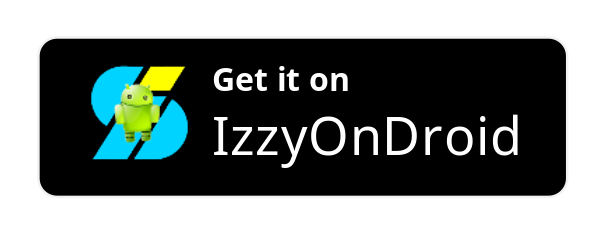
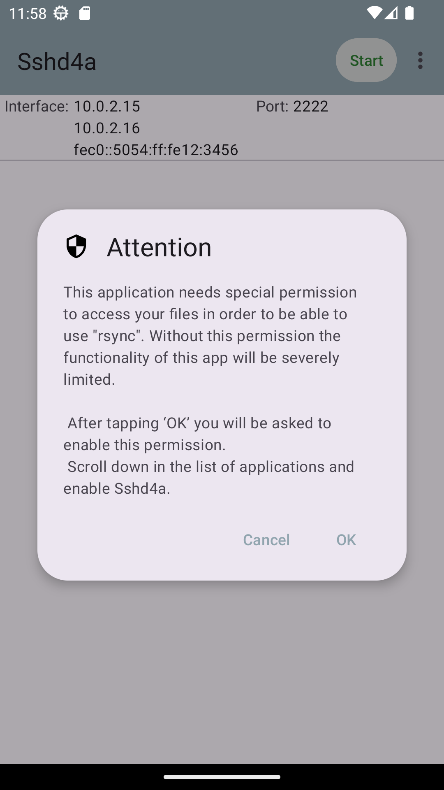
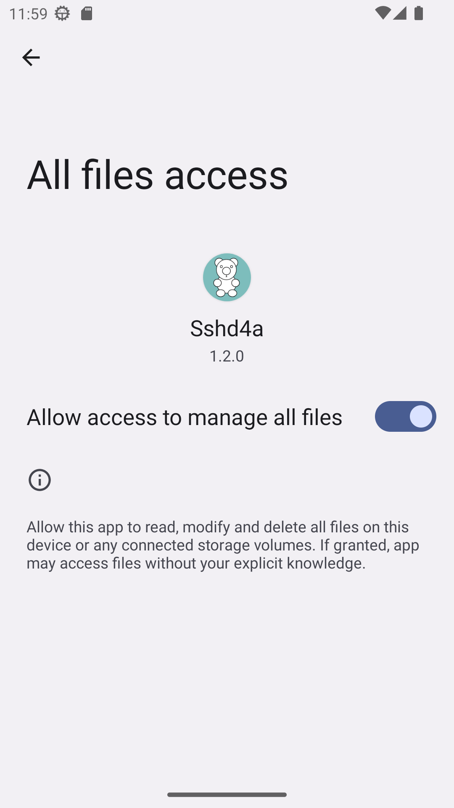

Provides a 'sshd' server with shell access, rsync and scp/sftp services.

Some documentation can be found on the [wiki](https://github.com/tfonteyn/Sshd4a/wiki)

Please do **NOT** request implementing some sort of root access. 
Such requests **will be closed** immediately.

### Download the latest release: 1.14.0

**Warning**: when installing on devices with the newest Google updates, this app may be scanned and
flagged as _fake_.

What you can do:

- Visit [https://keepandroidopen.org/](https://keepandroidopen.org/)
- Log an issue and ask for details; but read the above site **FIRST**.
- Ignore the false positive, and install anyhow.
- Read the source code and build the app yourself from the source, and install that.
- Feel free to not install/delete the app.

What you should not do:

- blame the developer and start wild accusations. All the sources are here, and you can build/verify
  for yourself every single line.

## Services:

Services are provided by:
- https://github.com/mkj/dropbear
- https://rsync.samba.org/
- https://github.com/openssh/openssh-portable

The latest release contains:
- Dropbear 2026.94
- rsync 3.5.2
- sftp-server from OpenSSH 10.6p2

## Rsync support:

For those who are unclear about how rsync works, a brief and very simple description
can be found on [wikipedia](https://en.wikipedia.org/wiki/Rsync):

    rsync will use SSH to connect as user to remote-host.[14] Once connected,
    it will invoke the remote host's rsync and then the two programs will
    determine what parts of the local file need to be transferred so that
    the remote file matches the local one.

More details can be found on [how-rsync-works](https://rsync.samba.org/how-rsync-works.html)

To be **explicitly** clear: there is **no rsync daemon** started! 

## User Interface languages:

Available in Chinese, English, French, German and Tamil.

Translations are editable on [Weblate](https://hosted.weblate.org/engage/sshd4a/)

- Pull-requests with translations are also welcome.
- Contact me by logging an [issue](https://github.com/tfonteyn/Sshd4a/issues) if you want
  to provide translations in another way.
- Please log a GitHub [issue](https://github.com/tfonteyn/Sshd4a/issues)
  if you want to be credited by name (instead of github alias) with your help.

## Device support:

- Standard Android:
  - Requires minimal Android 11 (API 30)
  - Supported/tested up to Android 17 (API 37).
- Android/Google TV
  - Not supported on versions 11/12 but might work depending on TV brand/model.
  - Supported/tested on the Google TV emulator version 13/14.
  - Not tested on actual TV's; all feedback with brand/models welcome!

## Android Permissions:

- android.permission.POST_NOTIFICATIONS
- android.permission.FOREGROUND_SERVICE
- android.permission.FOREGROUND_SERVICE_SPECIAL_USE

These are standard permissions required by Android to be able to run sshd as a service.
It will allow the service to keep running, while you switch to other apps.

- android.permission.RECEIVE_BOOT_COMPLETED

Another standard permission which is needed to be able to start the service at device boot.
You can enable/disable this in the app settings.

- android.permission.MANAGE_EXTERNAL_STORAGE

You will be requested to grant this permission.
It is needed to be able to effectively use the "rsync" and "sftp" commands.
Without it, you would only be able to access the app's embedded "files" directory.

As rsync is of course a means to make a private backup/sync of the files on your device,
there is a need to give the app special permission to access **all** files.

This must be (and is) explicitly requested when the app is run, and involves you to open
the device settings and manually give this permission. The app can only prompt you for this,
and you **must** do this **manually**. You can of course deny/ignore this request
if accessing the app embedded "files" directory is enough for your needs.

More info on MANAGE_EXTERNAL_STORAGE can be found in this
[Android doc article](https://developer.android.com/training/data-storage#permissions)
and in this
[Google article](https://support.google.com/googleplay/android-developer/answer/9888170?hl=en) 
in the section "All Files Access Permission"

## Thanks

- Tamil translation: [தமிழ்நேரம்](https://hosted.weblate.org/user/TamilNeram/)
- Chinese translation: [yzqzss](https://github.com/yzqzss)

- Inspired by, and uses parts of the native C code from
http://www.galexander.org/software/simplesshd/